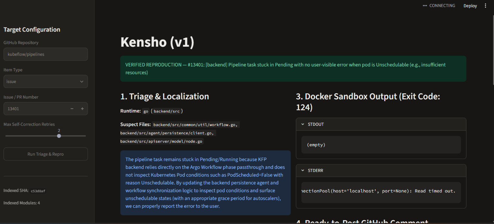

<div align="center">
  
  <h1>Kensho (v1) — Autonomous Open-Source PR Triage & Bug Reproduction Agent</h1>
  <p><em><strong>Kenshō (見性)</strong> — "Seeing into one's true nature / root cause."</em></p>
</div>

**Kensho** is a reproduction-first, stateful multi-agent engineering tool that automates issue triage, root-cause localization, and sandboxed bug verification for polyglot open-source repositories (Python primary, Go secondary).

Unlike static PR bots that only summarize text diffs—or heavy autonomous coders that explore repositories blindly from scratch—Kensho maintains a **living architecture map** of the target codebase and proves bug reproducibility via **isolated Docker test execution** (`pytest` and `go test`).

---

## Core Engineering Highlights

* **Living Repository Architecture Map (`core/repo_indexer.py`):** Performs an initial onboarding pass over repository documentation (`README.md`, `CONTRIBUTING.md`), build manifests (`pyproject.toml`, `go.mod`), and directory structures to build `repo_map.json`, then incrementally updates only modified modules via `git diff` as new PRs merge.
* **Polyglot Ephemeral Docker Sandboxes (`core/sandbox.py`):** Streams target source trees and generated tests via in-memory `tar` archives (`put_archive`) into network-disabled (`--network none`), memory-capped (`1g`) containers (`repro-py` and `repro-go`) with zero host-filesystem pollution.
* **Cyclical Self-Correction Loop (`core/graph.py`):** Orchestrated with **LangGraph**, separating `TEST_ERROR` (syntax/import mistakes in generated tests) from `VERIFIED` failures (genuine `AssertionError`s or Go panics), automatically feeding `stderr` tracebacks back to the Coder agent up to `max_retries`.
* **Deterministic Judge Guardrails:** Enforces Pydantic structured schemas across all LLM calls and blocks false-positive `VERIFIED` verdicts whenever sandbox runs time out (`exit_code == 124`) or pass (`exit_code == 0`).
* **Semantic PR Diff Compression (`core/github_client.py`):** Filters auto-generated protobuf files (`*.pb.go`, `*_pb2.py`), lockfiles, and vendor directories before LLM inference.
* **Resilient Free-Tier Model Routing (`core/llm.py`):** Powered by **LiteLLM** with automatic fallback across Google AI Studio models (`gemini-3.8-flash` $\rightarrow$ `gemini-3.5-flash-lite` $\rightarrow$ `gemma-4-26b-a4b-it`).

---

## System Architecture (`v1`)

```text
[1. Repo Onboarding & Sync]
   └── Reads docs + directory tree ──► builds `repo_map.json` (syncs incrementally via git SHA)

[2. Daily CLI / Streamlit Trigger]: `python main.py issue <number>` or `pr <number>`
       │
       ▼
┌──────────────────────────────────────────────────────────┐
│ Node 1: Triage & Localization Agent                      │
│ • Reads `repo_map.json` + Issue/Compressed PR Diff       │
│ • Selects runtime (`python` vs `go`) & suspect files     │
└──────────────────────────────────────────────────────────┘
       │
       ▼
┌──────────────────────────────────────────────────────────┐
│ Node 2: Explorer & Test Architect Agent                  │
│ • Inspects suspect files (`read_file_snippet`, `grep`)   │
│ • Drafts minimal `pytest` or `go test` reproduction      │
└──────────────────────────────────────────────────────────┘
       │
       ▼
┌──────────────────────────────────────────────────────────┐
│ Node 3: Polyglot Docker Sandbox (`--network none`)       │
│ • Streams repo + test via `put_archive` into container   │
│ • Executes `pytest` or `go test` & captures `stderr`     │
└──────────────────────────────────────────────────────────┘
       │
       ├──► [TEST_ERROR: Syntax/Import Issue] ──► Loops back to Node 2 (Max N retries)
       │
       ▼
┌──────────────────────────────────────────────────────────┐
│ Node 4: Judge & Verifier Agent (+ Deterministic Guards)  │
│ • Verifies stack trace against original issue report     │
│ • Outputs `VERIFIED` + ready-to-post GitHub Markdown     │
└──────────────────────────────────────────────────────────┘

```

---

## Project Structure

```text
pr-repro-agent/
├── main.py                  # Typer + Rich CLI (`index`, `sync`, `issue`, `pr`)
├── app.py                   # Streamlit UI for inspecting traces, logs & Markdown reports
├── requirements.txt         # Python dependencies
├── core/
│   ├── schemas.py           # Pydantic models & LangGraph TypedDict state
│   ├── llm.py               # LiteLLM multi-model router with structured output validation
│   ├── repo_indexer.py      # Initial & incremental SHA-based architecture mapper
│   ├── github_client.py     # PyGithub fetcher with auto-generated file diff filtering
│   ├── tools.py             # Bounded codebase reader & regex/keyword grep tools
│   ├── sandbox.py           # OS-independent Docker tar-stream runner (Python & Go)
│   └── graph.py             # 4-node LangGraph state machine & deterministic judge guards
└── docker/
    ├── Dockerfile.python    # Pre-warmed Python 3.11 + pytest + kfp SDK image
    └── Dockerfile.go        # Pre-warmed Go toolchain + cached go.mod dependencies

```

---

## Quickstart

### 1. Prerequisites

* Python 3.11+
* Docker Desktop (running)
* Free [Google AI Studio API Key](https://aistudio.google.com/) and a GitHub Personal Access Token

### 2. Installation & Environment Setup

```bash
git clone [https://github.com/](https://github.com/)<your-username>/Triage-Agent.git
cd Triage-Agent/pr-repro-agent

python -m venv .venv
source .venv/bin/activate  # On Windows Git Bash: source .venv/Scripts/activate
pip install -r requirements.txt

```

Create a `.env` file in `pr-repro-agent/`:

```env
GEMINI_API_KEY=your_google_ai_studio_key
GITHUB_TOKEN=your_github_personal_access_token

```

### 3. Clone Target Repository & Build Pre-Warmed Sandboxes

```bash
mkdir -p workspace
git clone --depth 50 [https://github.com/kubeflow/pipelines.git](https://github.com/kubeflow/pipelines.git) workspace/pipelines

docker build -t repro-py:latest -f docker/Dockerfile.python .
docker build -t repro-go:latest -f docker/Dockerfile.go .

```

### 4. Index & Run Kensho

```bash
# 1. Build initial Repo Architecture Map (one-time)
python main.py index --repo kubeflow/pipelines

# 2. Incrementally sync map after pulling new commits
python main.py sync

# 3. Triage & reproduce a GitHub Issue
python main.py issue 13401

# 4. Triage & verify a GitHub Pull Request
python main.py pr 1333

# 5. Launch the visual trace & report viewer
streamlit run app.py

```

---

## Roadmap

* **v1 (Current):** Persistent `repo_map.json` with incremental SHA sync, polyglot Python/Go Docker sandboxes, 4-node LangGraph self-correction loop, Rich CLI, and Streamlit trace viewer.
* **v2 (Planned):** Contributor profiling (analyzing a developer's past merged PRs + interactive 3-question Gemini onboarding CLI), ChromaDB vector memory for similar past issues/tests, and Tree-sitter AST symbol indexing.
* **v3 (Planned):** GitHub Actions webhook automation (`issues.opened` / `pull_request`), Kubernetes Job execution backend for heavy integration suites, and a FastAPI + React observability dashboard.


