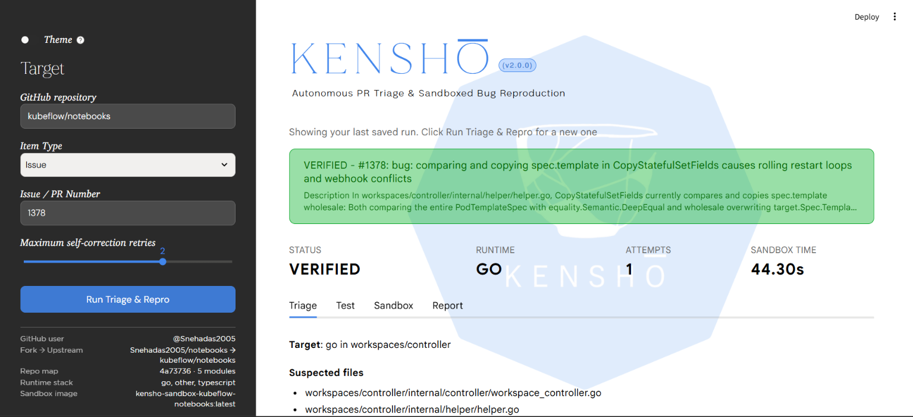
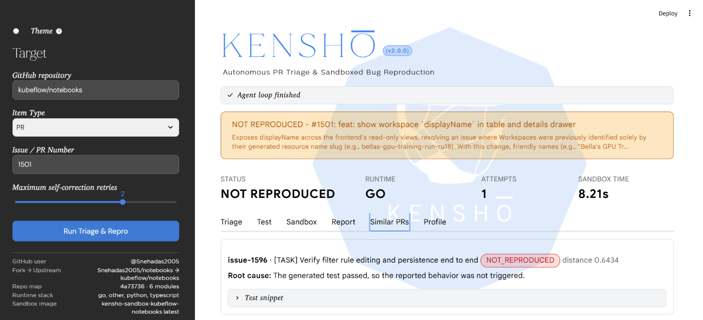

<div align="center">
  
</div>

<p align="center">
  <a href="https://github.com/Snehadas2005/Kensho/releases/tag/v2.0.0"></a>
  
  
</p>

# Kensho v2.0.0 — Fork-Aware Autonomous PR Triage & Sandboxed Bug Reproduction


**Kensho v2** turns any cloned GitHub fork into an autonomous bug-reproduction and PR-verification assistant. It detects your `origin` (fork) and `upstream` remotes automatically, indexes the codebase with Tree-sitter AST symbols, builds a cached Docker sandbox for the repo's tech stack, and remembers your contributor profile and past bug reproductions across runs.

---

## Project Structure (`version-2`)

```text
Kensho/
├── assets/
│   ├── fonts/                        # Local typography (MADE Mirage, Apparatus SIL, DM Sans, etc.)
│   ├── kensho-bg-light.png           # Light-mode watermark
│   ├── kensho-bg-dark.png            # Dark-mode watermark
│   └── kensho-logo.png               # App & browser tab logo
├── docs/
│   ├── Kensho-ui-issue.png           # Streamlit UI preview (Issue mode)
│   └── Kensho-ui-pr.png              # Streamlit UI preview (PR mode)
├── pr-repo-agent/
│   ├── .streamlit/config.toml        # Light-mode default + primary accent (#4186EC)
│   ├── main.py                       # Typer + Rich CLI (`config`, `init`, `onboard`, `recommend`, `issue`, `pr`, `sync`)
│   ├── app.py                        # Streamlit UI (Masthead, Metrics, 6 Tabs, Light/Dark Theme Toggle)
│   ├── ui_theme.py                   # Centralized theme variables, CSS builder & HTML components
│   ├── core/
│   │   ├── ast_symbols.py            # Tree-sitter Python & Go symbol extraction
│   │   ├── checkout.py               # Isolated `git worktree` checkout for PR branches
│   │   ├── errors.py                 # Friendly error formatting
│   │   ├── git_context.py            # Fork/upstream & contributor handle detection (`RepoContext`)
│   │   ├── github_client.py          # GitHub Issue/PR, diff, review comment & commit history fetcher
│   │   ├── go_module.py              # Go module root, package detection & import guardrails
│   │   ├── graph.py                  # 6-node LangGraph workflow + SQLite checkpointer + telemetry
│   │   ├── guards.py                 # Deterministic environment/syntax guardrails
│   │   ├── llm.py                    # LiteLLM multi-provider router (Gemini + OpenCode Zen) & telemetry
│   │   ├── repo_indexer.py           # Builds & incrementally syncs `repo_map.json`
│   │   ├── sandbox.py                # Polyglot Docker runner (Python & Go) with cached Go volumes
│   │   ├── schemas.py                # Pydantic models & `AgentState`
│   │   ├── stack_detector.py         # Auto-detects languages & builds cached repo Docker images
│   │   └── tools.py                  # `read_file_snippet`, `grep_codebase`, `get_git_blame`
│   ├── memory/
│   │   ├── profiler.py               # Scans past merged PRs + 3-question onboarding -> `profile.json`
│   │   ├── recommender.py            # Ranks open upstream issues matched to your profile
│   │   ├── updater.py                # Post-run updater for `profile.json`
│   │   └── vector_store.py           # ChromaDB semantic memory of past bugs & verified tests
│   └── tests/
│       ├── test_addons.py
│       ├── test_go_module.py
│       ├── test_guards.py
│       ├── test_memory.py
│       └── test_sandbox.py
├── pyproject.toml
├── pytest.ini
└── requirements.txt
```

---

## How `version-2` Differs from `version-1` (New Add-ons)

| Feature | Version 1 (`v1`) | Version 2 (`v2`) |
| --- | --- | --- |
| **Repo Targeting** | Hardcoded single-repo workspace (`kubeflow/pipelines`) | **Fork-aware (`core/git_context.py`)**: auto-detects `origin` (fork) and `upstream` from any cloned repo you `cd` into. |
| **Docker Environment** | Static `repro-py` / `repro-go` images only | **Auto-detected stack (`core/stack_detector.py`)**: `kensho init` inspects the repo and builds a cached `kensho-sandbox-<repo>:latest` image + persistent Go module/build volumes. |
| **PR Branch Testing** | Tested against local working tree only | **Isolated PR Checkout (`core/checkout.py`)**: `prepare_checkout` fetches `pull/<n>/head` into a temporary `git worktree` and cleans it up afterwards. |
| **Code Indexing** | Directory tree + `.md` docs only | **Tree-sitter AST Symbols (`core/ast_symbols.py`)**: extracts real Python/Go function, class, and type signatures so the LLM stops inventing file paths or symbols. |
| **Contributor Memory** | Stateless per run | **Adaptive Memory (`memory/`)**: `profiler.py` (`onboard`), `vector_store.py` (ChromaDB RAG of past bugs/tests), `recommender.py` (`recommend`), and `updater.py` (auto-updates `profile.json`). |
| **Persistence & Telemetry** | In-memory only | **SQLite Checkpointer + Telemetry**: persists LangGraph state in `.kensho/checkpoints.sqlite` and tracks per-node token usage, latency, and model failovers. |
| **UI & Theme** | Basic single-theme trace viewer | **Kensho v2 UI**: Light/Dark theme switch, custom local typography, and 6 structured tabs (`Triage`, `Test`, `Sandbox`, `Report`, `Similar PRs`, `Profile`). |

---

## What Each UI Tab Contains

#### Kensho Issue UI



#### Kensho PR UI



### 1. **Triage**
Shows *where* Kensho thinks the bug or PR change lives before running any code:
* **Target**: The detected programming language (`go` or `python`) and the folder where the test will run.
* **Suspected files**: The exact files in the repository most likely responsible for the issue or modified by the PR.
* **Search Keywords**: Important function names, error strings, or symbols extracted from the issue/PR.
* **Hypothesis**: A plain-English explanation of what is going wrong (or what the PR is changing) and how the test will trigger it.
* **Models**: Which AI model ran each step, how many tokens it used, and how long it took.

### 2. **Test**
Displays the **complete generated reproduction test** (`pytest` for Python or `go test` for Go) with line numbers and a copy button:
* **When running `kensho issue <n>`**: The test is written against your **current repo** to trigger the reported bug (expected to **fail** with an assertion/error if the bug exists).
* **When running `kensho pr <n>`**: Kensho checks out the **PR's actual branch** in an isolated worktree and generates a test targeting the PR's changed files and functions to verify whether the fix/feature works or still fails.

### 3. **Sandbox**
Shows the raw execution output from inside the isolated Docker container:
* **Exit code & timing**: Whether the test passed (`0`), failed (`1`), or timed out (`124`), how long Docker took, and how many attempts were needed.
* **STDOUT**: Standard output printed by `pytest` or `go test` (test names, `RUN`, `PASS`, `FAIL`).
* **STDERR**: Compiler errors, stack traces, missing imports, or container setup messages.

### 4. **Report**
Gives you the final AI summary ready to share with maintainers:
* **Root cause**: Why the test failed or passed based on the code and traceback.
* **Suggested fix direction**: Which file/function needs to be updated and how.
* **GitHub comment**: Side-by-side raw Markdown and rendered preview with a one-click copy button so you can paste the reproduction proof directly onto GitHub.

### 5. **Similar PRs**
Lists past issues and PRs retrieved from your local **ChromaDB** semantic memory (`chroma_db/`) that resemble the current issue—showing their status, root cause, and a reusable **Test snippet** so Kensho learns from previous runs.

### 6. **Profile**
Displays your contributor profile (`.kensho/profile.json`) created by `git kensho onboard` and updated after runs—your GitHub handle, preferred languages, focus areas, preferred subdirectories, and recent merged PRs.
